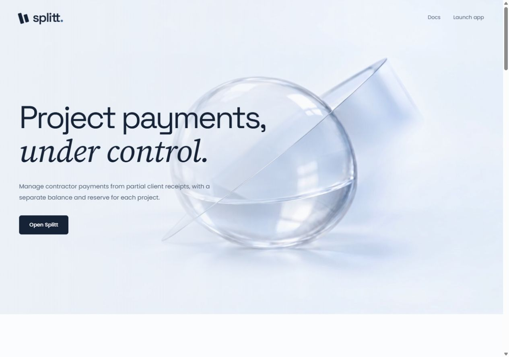
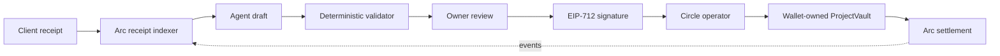

# Splitt

Splitt helps agencies decide what to pay when a client pays only part of an invoice. It keeps each project's money separate, protects an owner-set reserve, drafts a payment plan from recorded obligations and asks the owner to sign the exact batch before any USDC moves.

[Website](https://www.usesplitt.xyz) · [Live testnet app](https://www.usesplitt.xyz/start) · [Wallet-free demo](https://www.usesplitt.xyz/demo) · [Documentation](https://www.usesplitt.xyz/docs)



## What works today

The public release runs on **Arc Testnet**. A visitor can connect MetaMask or Rabby, deploy a wallet-owned vault, create one project, record contractor obligations, deposit test USDC, review an automatic draft and sign a payout. A Circle developer-controlled wallet submits the signed batch. The server cannot change recipients or amounts and cannot pay without the vault owner's EIP-712 signature.

The no-wallet demo uses a fixed example: a 2,000-USDC invoice, 1,200 received and a 300 reserve. It proposes 700 to one contractor and a permitted 200 partial payment to another. When the 800 remainder arrives, the new plan includes only the outstanding 300. Demo settlement is simulated and clearly labelled.

The hosted testnet release has verified:

- three controlled wallet-owned vaults;
- four Circle-executed payout batches totalling 2.4 test USDC;
- receipt-triggered drafts, remainder handling and chain-based recovery;
- signed sessions, CSRF and replay rejection, and isolation between wallets;
- 189 automated tests, strict TypeScript checks and a production Next.js build.

These are controlled engineering tests. Verified businesses and customer payment volume remain zero.

## Why the agent is safe

The agent drafts; it does not control money. It reads current project facts and may suggest payments or allowed deferrals. A deterministic validator checks the reserve, eligibility, partial-payment terms, per-payment and daily caps, evidence references and stale state. Invalid or unavailable model output falls back to the rule-based plan.

Payment-note matching uses Claude Haiku 5.5 with a deterministic fallback. Two runs on ten synthetic regression cases scored 10/10 for the combined path and 7/10 for literal matching. Five model answers were accepted and five safety cases fell back in each run. This is a small development check, not a production accuracy claim. See [the evaluation](docs/anthropic-evaluation.md).

## Architecture



- **Web:** Next.js 16, wallet connection, setup, review, signing and recovery.
- **API:** Fastify, SIWE sessions, CSRF protection, per-wallet authorization and rate limits.
- **State:** PostgreSQL queues, event cursors, execution journals and isolated vault workspaces.
- **Contracts:** Solidity 0.8.28, OpenZeppelin 5.4, project accounting, delayed recipients, caps, replay protection and atomic batches.
- **Execution:** Circle developer-controlled operator with durable idempotency and on-chain reconciliation.

## Evidence

The original V1 vault is [`0x724c…c6c6`](https://explorer.testnet.arc.io/address/0x724c12bea7fab30e27a9b3f4d5581351ebc2c6c6). Sourcify reports exact creation and runtime matches for its historical build. Public self-serve deployment uses a pinned V1 creation artifact. Run `npm run vault:bytecode:check` to compare both artifacts with their reviewed hashes and the current on-chain runtime. `ProjectVaultV2` is a separate, undeployed mainnet candidate; the current dependency tree is not presented as the historical V1 build.

- [First contractor batch: 0.7 + 0.2 USDC](https://explorer.testnet.arc.io/tx/0x938ea7d6370c06d25daf6c73493e5c43f304abf9938563b7bd934325edaebdc5)
- [Remainder deposit: 0.8 USDC](https://explorer.testnet.arc.io/tx/0xde2ce4f47108ab118ef30b7dd835b7da7dae60ed7b83504ead5011acddd35c6d)
- [Final contractor payment: 0.3 USDC](https://explorer.testnet.arc.io/tx/0x098fa70efda77e5f22396521bce7d5ccdeb3bbbaab8997e9ae8551a0ceb32881)
- [Public onboarding proof](docs/public-onboarding-proof.json)
- [Two-wallet isolation and recovery proof](docs/selfserve-testnet-proof.json)
- [Public authentication proof](docs/public-access-proof.json)

The 96-second film is built from [`video/`](video/README.md) and renders to `video/out/splitt-film.mp4`. It is a motion-design piece with an original generated score. Illustrative scenes are badged, and only the evidence scene shows real Arc Testnet transactions. Upload the MP4 to Loom, YouTube or Vimeo before putting it in a submission form.

## Run locally

Node.js 22 or newer is required. Fixture mode needs no wallet, database or API key.

```sh
npm ci
npm run dev
```

Open [localhost:3000](http://localhost:3000). The web app talks to the local API on `127.0.0.1:4000`. Fixture data stays in `server/.data/fixture.json`. Use the in-app reset control to restore it.

Copy `.env.example` to `.env` only when you need PostgreSQL, model access or Arc Testnet. Keep every credential server-side. The public self-serve environment is documented in [the testnet runbook](docs/selfserve-testnet.md).

## Verify a change

```sh
npm run typecheck
npm test
npm run contracts:compile
npm run build
npm run release:check
```

`npm run arc:check` performs a read-only Arc Testnet RPC check. `npm run mainnet:check` performs a read-only Arc Mainnet preflight and exits nonzero while production gates are missing.

## Mainnet path

Arc Mainnet is available, but Splitt is not being presented as production-ready. The current contract is unaudited and the running service is intentionally locked to Arc Testnet chain `5042002` and Circle `ARC-TESTNET` wallets.

The separate `ProjectVaultV2` mainnet candidate makes the recipient delay immutable and enforces the reserve against owner withdrawals. Mainnet still requires an independent audit, Arc Foundry fork tests, a separate Circle `ARC` operator, a multisig or policy-controlled owner, a production database and restore drill, monitoring, legal/support copy and a capped real-business pilot. The complete gate and release order are in [mainnet readiness](docs/mainnet-readiness.md). No mainnet deployment command is included until those controls are complete.

## Security model

- The model cannot sign, select wallet addresses, change policy or submit a transaction.
- Every authorization binds the chain, vault, plan, project version, ordered payments and expiry.
- Reused plan, execution and attribution IDs revert.
- Recipient failures roll back the entire batch.
- Policy changes make earlier signatures stale.
- The owner can pause payments or remove the operator.

The deployed testnet contract lets the owner withdraw below the reserve. That behavior remains documented for compatibility. The V2 mainnet candidate treats the reserve as a hard constraint for operator payouts and owner withdrawals.

## Project guides

- [Product and contract specification](docs/project-spec.md)
- [Build status](docs/build-status.md)
- [Judge-ready evidence map](docs/judge-readiness.md)
- [Mainnet readiness](docs/mainnet-readiness.md)
- [Security review](docs/security-review-2026-10-18.md)
- [VPS deployment](docs/vps-deployment.md)
- [Hackathon submission copy](docs/submission-copy.md)

MIT licensed.
