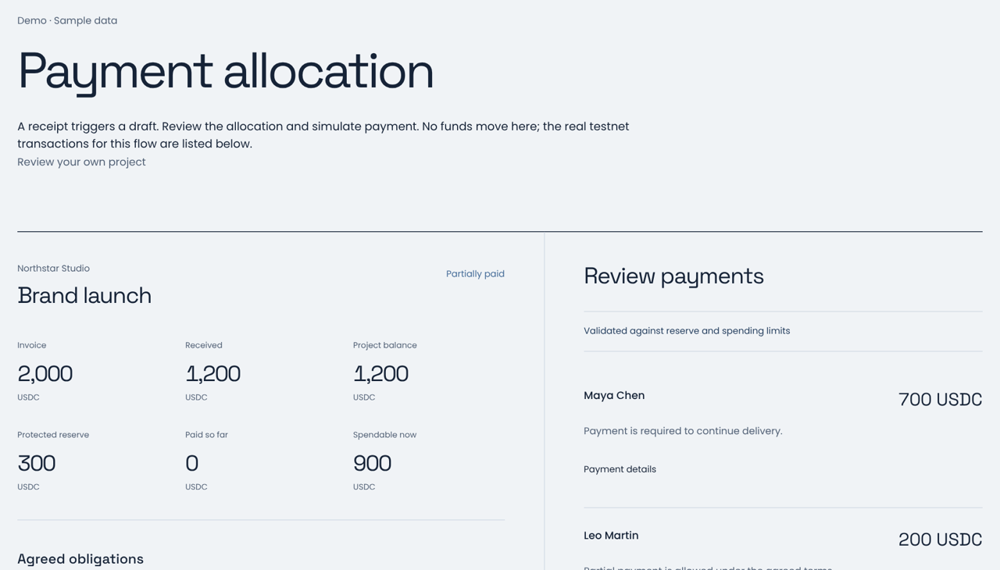
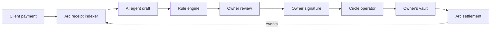

# Splitt

**Payment plans with a reason behind every amount.**

When a client pays only part of an invoice, Splitt works out who gets paid, how much and why. An AI agent drafts the split, fixed rules check it, and nothing moves until the owner signs the exact batch. Payouts settle in USDC on Arc, executed through Circle.

[](docs/media/splitt-demo.mp4)

_A short preview. [Watch the full film with sound and captions (1:30)](docs/media/splitt-demo.mp4)._

[Website](https://www.usesplitt.xyz) · [Launch the app](https://www.usesplitt.xyz/start) · [Try it without a wallet](https://www.usesplitt.xyz/demo) · [Docs](https://www.usesplitt.xyz/docs)

## The problem

Agencies get paid in pieces. A client sends 1,200 of a 2,000 invoice, two contractors are waiting, and some cash has to stay in reserve. Deciding who to pay is guesswork in a spreadsheet, and paying the wrong person or paying twice is hard to undo.

## What Splitt does

1. **Keeps each project's cash separate.** Every project has its own balance in a vault the owner controls. One client's money never covers another client's bills.
2. **Protects a reserve.** The owner sets a minimum that payouts can never touch.
3. **Drafts the split.** When money arrives, an AI agent reads the invoice, the contractor terms and the cash, then proposes a plan. For example: 700 to Maya in full and a permitted 200 partial payment to Leo.
4. **Checks every line.** A rule engine that runs separately from the model checks the reserve, eligibility, caps, evidence and current state. If the model's draft fails, Splitt falls back to a plan built from the rules alone.
5. **Waits for your signature.** The owner signs the exact batch (vault, payments, order and deadline) in their own wallet. Circle executes it, Arc settles it, and Splitt reconciles it from the chain.
6. **Replans when the rest arrives.** When the remaining 800 lands, Splitt pays Leo's outstanding 300 and nothing else. An old approval can never be used twice.

## Try it

The wallet-free demo walks through the same example as the film: 1,200 of a 2,000 invoice arrives, 300 stays in reserve, Maya is paid 700 in full and Leo gets a permitted 200, then the remaining 800 settles Leo's last 300.

[](https://www.usesplitt.xyz/demo)

| Option                                             | What you need                                    |
| -------------------------------------------------- | ------------------------------------------------ |
| [Wallet-free demo](https://www.usesplitt.xyz/demo) | Nothing. A fixed example with simulated payouts. |
| [Live app](https://www.usesplitt.xyz/start)        | MetaMask or Rabby and Arc Testnet USDC.          |
| [Run it locally](#run-locally)                     | Node.js 22. No wallet, database or API key.      |

## Status

| Stage       | State                                                                                                                                                                                                                 |
| ----------- | --------------------------------------------------------------------------------------------------------------------------------------------------------------------------------------------------------------------- |
| Arc Testnet | **Live.** Self-serve vaults, automatic drafts, owner signing and Circle-executed payouts. The vault contract has an exact Sourcify match.                                                                             |
| Arc Mainnet | **Launch in progress.** The `ProjectVaultV2` contract is ready for audit and supports multisig owners. The steps to launch, and where each one stands, are in the [mainnet launch plan](docs/mainnet-launch-plan.md). |

## How it works



| Layer     | Built with                                                                                                   |
| --------- | ------------------------------------------------------------------------------------------------------------ |
| Web       | Next.js 16: wallet connection, setup, review, signing and recovery                                           |
| API       | Fastify, sign-in with Ethereum, CSRF protection, per-wallet authorization and rate limits                    |
| Agent     | Claude Haiku for drafts and payment-note matching, with a rule-based fallback                                |
| State     | PostgreSQL job queues, event cursors, execution journals and isolated workspaces                             |
| Contracts | Solidity 0.8.28 and OpenZeppelin 5.4: per-project accounting, delayed recipients, caps and replay protection |
| Execution | Circle developer-controlled wallet as operator, with idempotent jobs and on-chain reconciliation             |

## Why the money is safe

- The AI agent drafts plans only. It can't sign, pick wallet addresses, change policy or send a transaction.
- Every signature binds the chain, vault, plan, project version, ordered payments and expiry.
- Reused plan, payment and attribution IDs are rejected on chain.
- If any recipient fails, the whole batch rolls back.
- Changing a policy makes earlier signatures stale.
- The owner can pause payouts or remove the operator at any time.
- V2 treats the reserve as a hard limit for payouts and owner withdrawals alike, and accepts multisig (ERC-1271) owner signatures.

See the [security review](docs/security-review-2026-10-18.md) and [contract specification](docs/project-spec.md).

## Run locally

```sh
npm ci
npm run dev
```

Open [localhost:3000](http://localhost:3000). The app runs on fixture data by default and talks to the local API on `127.0.0.1:4000`. Use the in-app reset control to restore the fixture. Copy `.env.example` to `.env` only when you need PostgreSQL, model access or a live network, and keep every credential server-side.

## Verify a change

```sh
npm run typecheck          # strict TypeScript
npm test                   # 213 tests, including contract tests on a local chain
npm run contracts:compile
npm run build
npm run release:check      # scans the release for credentials
```

`npm run mainnet:check` is a read-only Arc Mainnet preflight. It lists every launch requirement still missing and exits nonzero until all of them are met.

## Evidence

- Vault contract [`0x724c…c6c6`](https://explorer.testnet.arc.io/address/0x724c12bea7fab30e27a9b3f4d5581351ebc2c6c6) with an [exact Sourcify match](https://repo.sourcify.dev/5042002/0x724c12bea7fab30e27a9b3f4d5581351ebc2c6c6). `npm run vault:bytecode:check` compares it with the reviewed hashes.
- Testnet payouts: [first batch](https://explorer.testnet.arc.io/tx/0x938ea7d6370c06d25daf6c73493e5c43f304abf9938563b7bd934325edaebdc5) · [remainder deposit](https://explorer.testnet.arc.io/tx/0xde2ce4f47108ab118ef30b7dd835b7da7dae60ed7b83504ead5011acddd35c6d) · [final payment](https://explorer.testnet.arc.io/tx/0x098fa70efda77e5f22396521bce7d5ccdeb3bbbaab8997e9ae8551a0ceb32881)
- Proofs: [public onboarding](docs/public-onboarding-proof.json) · [wallet isolation and recovery](docs/selfserve-testnet-proof.json) · [authentication](docs/public-access-proof.json) · [model evaluation](docs/anthropic-evaluation.md)

## More

- [Mainnet launch guide](docs/mainnet-launch-guide.md), [launch plan](docs/mainnet-launch-plan.md) and [readiness gates](docs/mainnet-readiness.md)
- [Product and contract specification](docs/project-spec.md)
- [Demo film source](video/README.md) (narration, music and captions are generated from code)
- [VPS deployment](docs/vps-deployment.md)
- [Hackathon submission copy](docs/submission-copy.md)

MIT licensed.
