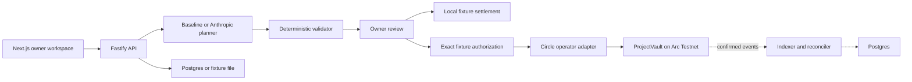

# Splitt

A project payment workspace for agencies. When a client pays part of an invoice, Splitt proposes which approved contractors can be paid, protects the project reserve, and explains what remains unpaid.

[Public website](https://splitt-dun.vercel.app) · [Interactive synthetic demo](https://splitt-dun.vercel.app/demo) · [Source repository](https://github.com/IamHarrie-Labs/splitt). The authenticated testnet API/worker currently runs locally; the hosted demo cannot move funds.

[2:40 walkthrough preview and captions](https://github.com/IamHarrie-Labs/splitt/releases/tag/v0.1.0-preview). This captured-UI preview predates publication; its closing localhost URL is superseded by the public demo above. Final payout/model/pilot evidence remains pending.

## Current build

The public `/demo` runs the deterministic allocation engine in the browser with synthetic data. The authenticated `/testnet` workspace connects to Arc balances, a PostgreSQL queue and Circle execution. The vault is deployed at `0x724c12bea7fab30e27a9b3f4d5581351ebc2c6c6`; [Sourcify confirms exact creation/runtime bytecode matches](https://repo.sourcify.dev/5042002/0x724c12bea7fab30e27a9b3f4d5581351ebc2c6c6). A real Circle contract query is confirmed, with zero transferred value. **Contractor payouts remain gated until 15 October 2026, 16:18:53 Lagos.** Live evaluation accepted 5/10 Nemotron outputs and 0/10 Poolside outputs; fallback kept all final plans valid. [Model reliability remains a release gap](docs/model-evaluation.md). Real pilot adoption remains pending. Fixture amounts do not count as adoption.

Implemented:

- Next.js workspace: projects, incoming payments, allocation, settlement and metrics.
- Create projects and approved commitments; record arrivals; confirm unknown payments once.
- Exact micro-USDC integers; deterministic baseline planner; model adapter with one correction attempt and labelled fallback.
- Validator for eligibility, amounts, partial terms, reserve, daily cap, references, stale facts and hidden shortfalls.
- Local simulation with replay rejection, interrupted callback and reconciliation.
- Solidity `ProjectVault`: project isolation, deposits, replay-safe attribution, owner withdrawal, pause/revocation, EIP-712 owner authorization and atomic batches.
- Relational Postgres repositories, transaction locks, append-only audit entries and additive migrations.
- Single-use EIP-4361 owner challenges, revocable sessions, CSRF checks and exact EIP-712 fixture approval in the browser.
- Separate Arc Testnet workspace, chain-derived balances and receipt indexing, a durable PostgreSQL execution queue, Circle wallet/network verification and replay-flag reconciliation. Deployment, Circle query execution and authenticated indexing are verified; full payout/remainder and recovery proof remain pending.

## Run locally

Arc Testnet integration setup: [testnet runbook](docs/testnet-runbook.md). `/testnet` exposes its connection state and, when configured, owner login, project metadata registration, allocation review and settlement status. Default fixture mode remains credential-free. [Submission draft](docs/submission.html) and [pilot plan](docs/pilot-plan.md) are prepared; neither represents a completed public submission or an onboarded business.

The landing page is at `/`. Choose **Open demo** to enter `/demo`, which needs no wallet or API. The local full fixture workspace remains `/workspace`; when the connected API runs in live mode, that workspace redirects to the authenticated `/testnet` page. See [publication runbook](docs/publication-runbook.md) for Vercel web setup and the separate persistent API host.

Node.js 22 or newer. No wallet, database or API key is needed for fixture mode.

```sh
npm ci
npm run dev
```

Open [localhost:3000](http://localhost:3000). The API binds to `127.0.0.1:4000`. Both processes stay local. The API persists fixture data in `server/.data/fixture.json`; use **Reset demo** to restore sample data. Do not publish fixture mode as a production service.

The browser and API expect the same origin, `http://localhost:3000`. Use that URL instead of `http://127.0.0.1:3000` when submitting forms. To change it, copy `.env.example` to `.env` and edit `WEB_ORIGIN`. Keys belong only in the root `.env` or a host secret store, never a browser form.

Optional AI: set `ANTHROPIC_API_KEY` and an account-available `PLANNER_MODEL`, or `PLANNER_PROVIDER=vercel-gateway`, `AI_GATEWAY_API_KEY` and `PLANNER_MODEL`, in server-only configuration, then restart the server. Without the selected credential and model, plans are clearly labelled **Deterministic baseline**. There are no automatic external messages.

## Walk through the demo

1. Northstar has received 1,200 of a 2,000 USDC invoice. Its reserve is 300.
2. Open **Allocation review** and generate a proposal: 700 to Amara and 200 to Tobi. The 300 reserve stays protected.
3. Choose **Review & simulate**. Optionally interrupt the confirmation callback.
4. If interrupted, open **Settlement** and reconcile the original batch; there is no second payment.
5. Add the 800 remainder in **Incoming payments**. Replan: only Tobi’s remaining 300 is proposed.
6. The final project balance is 800. Fieldwork’s separate 1,000 remains untouched.
7. Test an unknown payer by ticking **Unknown sender**. Its amount stays outside project balances until you confirm it.

No explorer links or transaction hashes are fabricated for local fixtures. The demo clock is fixed to 3 October 2026 so deadline tests are repeatable.

## Verify

```sh
npm run typecheck
npm test
npm run contracts:compile
npm run build
npm run arc:check
```

The test suite uses solc 0.8.28, OpenZeppelin 5.2.0, the Paris EVM target and IR compilation. Foundry settings are supplied, but Foundry is not installed on the current machine; the executable contract tests use Ganache and viem instead. Ganache uses its JavaScript fallback on Node 24 because an optional native WebSocket binary is unavailable. This does not prevent test execution.

The Arc check is read-only and verifies chain ID and ERC-20 decimals. Funded owner/operator wallets, vault deployment and project deposits have been verified. The prepared `testnet:prove` command refuses execution before contractor activation. Evidence is recorded under `docs/`; see [testnet runbook](docs/testnet-runbook.md).

## Database

Docker and Postgres are not required for the local fixture demo. The live schema uses Postgres exclusively:

```sh
docker compose up -d
# Set DATABASE_URL in your shell before migration.
npm run db:migrate
```

Copy `.env.example` to `.env`, set `SPLITT_STORAGE=postgres`, `DATABASE_URL` and your public `OWNER_ADDRESS`, then run `npm run db:migrate` and restart the app. The migration command reads the root `.env`. A fresh database receives sample projects once. Existing file-demo history is not imported. Database workspaces require owner sign-in and cannot reset the audit trail.

Migrations and repository workflows are tested on PGlite and a native PostgreSQL 17.10 server, including the real TCP driver, row locking, rollback, signed owner sessions and restart persistence. See [Postgres evidence](docs/postgres-verification.json). `npm run db:start` manages the isolated local cluster when configured. One owner is supported; cloud hosting needs its own managed database.

## Owner login and batch signing

See [owner authentication and signing setup](docs/owner-auth-and-signing.md). Set `OWNER_ADDRESS` to require signed login in file mode; it is mandatory for Postgres. Set a non-zero `VAULT_ADDRESS` to enable **Sign exact fixture batch** in Allocation review. Select Arc Testnet (5042002) in your wallet, review the exact batch, then sign.

**Fixture signatures use the `Splitt Fixture` domain. They cannot execute on a deployed `Splitt` vault.** A configured vault address does not prove deployment. Live authorization still requires fresh Arc state and current on-chain owner verification. Signing does not settle a fixture; simulation remains separate.

## Architecture



## Remaining release gates

1. Execute the prepared Circle payout, remainder and recovery proof after 15 October at 16:18:53 Lagos.
2. Deploy the API and PostgreSQL on the owner's VPS; verify HTTPS, signed owner access and worker restart recovery. See [VPS deployment](docs/vps-deployment.md).
3. Establish reliable real-model behavior and report validation/fallback rates honestly.
4. Onboard one consenting business with real invoice and contractor facts; synthetic scenarios stay excluded from adoption.
5. Refresh the video with final evidence, upload to Loom/YouTube/Vimeo and complete the organizer's form. [Submission copy](docs/submission-copy.md) is ready for the owner.

CCTP, USYC, document extraction and contractor share links remain optional/unimplemented. Integrations stay gated by `docs/project-spec.md`. No pilot or mainnet readiness is claimed.

## Security boundaries

The model cannot sign, select addresses or modify policy. The vault accepts operator payouts only with the current owner’s EIP-712 signature. Domain binding includes chain ID and vault address; authorization binds plan, project version, ordered items and expiry. Reusing plan, execution or attribution IDs fails. A recipient transfer failure rolls back the entire batch. A changed owner policy invalidates prior signatures through the project version.

The owner can withdraw below the reserve, by design; the reserve limits delegated operator spending. Contract source is unaudited and intended for testnet only. Direct `deposit()` credits the named project; unknown payer invoice matching is a separate app-level review and must not double-credit the deposit during live indexing.

MIT license. Product spec: [docs/project-spec.md](docs/project-spec.md). Progress: [docs/build-status.md](docs/build-status.md).
